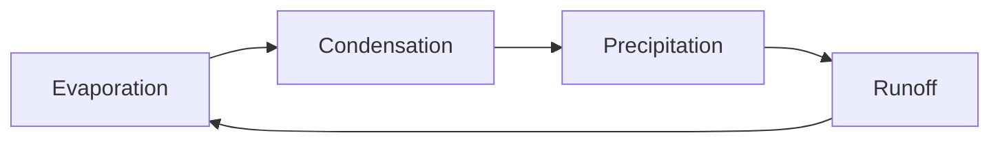

# Mermaid Circular Layout for Obsidian

An Obsidian plugin that adds a circular layout to Mermaid flowcharts.

The layout code is at
[pele-layout-circular](https://github.com/AndrewBroz/pele-layout-circular).
Its sibling,
[mermaid-layout-circular](https://github.com/AndrewBroz/mermaid-layout-circular),
shows examples of the output and explains some of the behavior, including
direction mechanics, spoke handling, and branching. Both place nodes with
the same math.

### How it fits into Obsidian

Since 1.15, Obsidian draws diagrams with
[Pele](https://github.com/obsidianmd/pele), its own renderer, which
has its own layout and no way to plug in another. So this plugin
carries a private copy of Pele's flowchart, wrapped with
[pele-layout-circular](https://github.com/AndrewBroz/pele-layout-circular),
and steps in only for diagrams that ask for a circular layout. Every
other diagram is still drawn by Obsidian's Pele, exactly as before.

Because circular diagrams are drawn by Pele too, they look like every
other diagram in your vault: they follow your theme, accent color,
font and light or dark mode, and zoom the same way. Like any diagram
in Obsidian, they ignore mermaid's `theme:` and `look:` settings.

The hand-off relies on `pele.mount`, which Obsidian uses internally
but does not document for plugins, so a future Obsidian release could
move it. If that happens, the plugin says so in a notice and leaves
your diagrams to Pele.

## Usage

Use the circular layout by setting the config in the front-matter:

````

````

`layout: circular` goes clockwise from the top.
`layout: circular-ccw` is the counter-clockwise variant.

Supports cycles, hub-and-spoke shapes, interlocking cycles, subgraphs etc.
Chords, edges between nodes that aren't neighbors on the ring, are
straight lines. Set `flowchart: { curve: linear }` in the same config for
straight edges all round; two opposite edges then become parallel
lines, with their labels on either side. A subgraph is a tight box
around its members, with its title at the bottom when edges cross the
top. A subgraph that spans half the ring or more is drawn as a band
that follows the ring. Edges over a filled subgraph take the ink for
that fill.
For what the layout does not handle yet, see "Not handled yet" in the
[pele-layout-circular README](https://github.com/AndrewBroz/pele-layout-circular#not-handled-yet).

## Installation

Until the plugin is in the community catalog, you can use
[BRAT](https://community.obsidian.md/plugins/obsidian42-brat)
(this is what I do, personally)

If you would prefer to install it manually:

1. Download `main.js` and `manifest.json` from the latest release, or
   build them yourself (below).
2. Copy both into `<your vault>/.obsidian/plugins/mermaid-circular/`.
3. In Obsidian, enable the plugin under Settings, Community plugins.

## Building from source

```sh
npm install
npm run build
```

This bundles Pele's flowchart and the circular layout into a
minified `main.js` of about 210 KB (about 83 KB gzipped). During development, `npm run dev`
rebuilds on change.

To check a change in a real Obsidian, without touching your own app or
vaults, run a sandboxed instance with the notes in `sandbox-fixtures/`:

```sh
bash scripts/obsidian-sandbox/obsidian-sandbox.sh start
```

## Requirements

Obsidian 1.15.0 or later. Disabling the plugin hands circular
diagrams straight back to Pele.

## License

MIT
