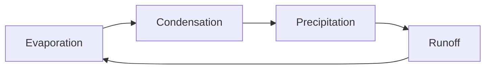

# Mermaid Circular Layout for Obsidian

An Obsidian plugin that adds a circular layout to mermaid flowcharts.
Cycles render as rings instead of dagre's flattened ladders. A diagram
with side branches keeps its ring: the cycle stays on the circle and
the rest hangs off it radially, the way a textbook draws the Krebs
cycle.

The layout itself lives in
[mermaid-layout-circular](https://github.com/AndrewBroz/mermaid-layout-circular),
which has pictures of the output and notes on how the geometry works.

### How it fits into Obsidian

Since 1.15, Obsidian no longer ships mermaid. It draws diagrams with
[Pele](https://github.com/obsidianmd/pele), its own renderer, which
has its own layout and no way to plug in another. So this plugin
carries its own copy of mermaid and steps in only for diagrams that
ask for a circular layout. Every other diagram is still drawn by
Pele, exactly as before. Because mermaid paints with its own palette,
circular diagrams use mermaid's light or dark theme colors rather than
the colors of your Obsidian theme.

The hand-off relies on `pele.mount`, which Obsidian uses internally
but does not document for plugins, so a future Obsidian release could
move it. If that happens, the plugin says so in a notice and leaves
your diagrams to Pele.

On Obsidian 1.13 and 1.14, which still bundled mermaid, the plugin
registers the layout with that mermaid instead.

## Usage

Opt in per diagram with frontmatter inside the mermaid fence:

````

````

Diagrams without the frontmatter are untouched.

`layout: circular` walks the ring clockwise from the top;
`layout: circular-ccw` walks it counter-clockwise — the same layout
seen in a mirror.

Hub-and-spoke shapes need no extra syntax: a star's center or a
wheel's axle is detected and moves to the middle on its own, with the
spokes drawn straight from border to border. A pendant cycle becomes
a satellite circle outside the main ring, and two cycles sharing a
node draw as a figure-eight, tangent at the shared node and flowing
against each other like meshing gears. Subgraphs
draw as boxes: members are seated side by side so the box wraps one
arc of the ring, and a subgraph around a pendant cycle wraps the
whole satellite.

## Installation

Until the plugin is in the community catalog, install it manually:

1. Download `main.js` and `manifest.json` from the latest release, or
   build them yourself (below).
2. Copy both into `<your vault>/.obsidian/plugins/mermaid-circular/`.
3. In Obsidian, enable the plugin under Settings, Community plugins.

## Building from source

```sh
npm install
npm run build
```

This bundles mermaid, the layout engine and the adapter into a
minified `main.js` of about 3.5 MB. During development, `npm run dev`
rebuilds on change.

To check a change in a real Obsidian, without touching your own app or
vaults, run a sandboxed instance with the notes in `sandbox-fixtures/`:

```sh
bash scripts/obsidian-sandbox/obsidian-sandbox.sh start
```

## Requirements

Obsidian 1.13.0 or later.

> [!TIP]
> On Obsidian 1.13 and 1.14, mermaid keeps registered layouts for the
> life of the app process and offers no way to unregister one, so after
> disabling the plugin the layout remains available until Obsidian
> restarts. From 1.15, disabling the plugin hands circular diagrams
> straight back to Pele.

## License

MIT
