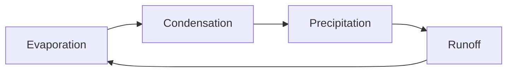

# Mermaid Circular Layout for Obsidian

An Obsidian plugin that adds a circular layout to Mermaid flowcharts.

The layout code is at
[mermaid-layout-circular](https://github.com/AndrewBroz/mermaid-layout-circular),
which shows examples of the output and explains some of the behavior, including
direction mechanics, spoke handling, and branching.

### How it fits into Obsidian

Since 1.15, Obsidian no longer ships mermaid. It draws diagrams with
[Pele](https://github.com/obsidianmd/pele), its own renderer, which
has its own layout and no way to plug in another. So this plugin
carries its own copy of mermaid and steps in only for diagrams that
ask for a circular layout. Every other diagram is still drawn by
Pele, exactly as before.

Circular diagrams are dressed to match: the plugin reads the same
colors, font and corner radius Obsidian gives Pele, so they follow
your theme, accent color and light or dark mode, and redraw when
those change. A diagram that sets its own `theme:` or `look:` in its
frontmatter keeps it.

The hand-off relies on `pele.mount`, which Obsidian uses internally
but does not document for plugins, so a future Obsidian release could
move it. If that happens, the plugin says so in a notice and leaves
your diagrams to Pele.

On Obsidian 1.13 and 1.14, which still bundled mermaid, the plugin
registers the layout with that mermaid instead.

## Usage

Use the circular layout by setting the config in the front-matter:

````

````

`layout: circular` goes clockwise from the top.
`layout: circular-ccw` is the counter-clockwise variant.

Supports cycles, hub-and-spoke shapes, interlocking cycles, subgraphs etc.

## Installation

Until the plugin is in the community catalog, you can use
[BRAT](https://community.obsidian.md/plugins/obsidian42-brat)
(this is what I do, personally)

If you would prefer to install it manually:

1. Download `main.js` and `manifest.json` from the latest release, or
   build them yourself (below).
2. Copy both into `<your vault>/.obsidian/plugins/mermaid-circular/`.
3. In Obsidian, enable the plugin under Settings, Community plugins.

## Building from source

```sh
npm install
npm run build
```

This bundles mermaid, the layout engine and the adapter into a
minified `main.js` of about 3 MB. During development, `npm run dev`
rebuilds on change.

To check a change in a real Obsidian, without touching your own app or
vaults, run a sandboxed instance with the notes in `sandbox-fixtures/`:

```sh
bash scripts/obsidian-sandbox/obsidian-sandbox.sh start
```

## Requirements

Obsidian 1.13.0 or later.

> [!TIP]
> On Obsidian 1.13 and 1.14, mermaid keeps registered layouts for the
> life of the app process and offers no way to unregister one, so after
> disabling the plugin the layout remains available until Obsidian
> restarts. From 1.15, disabling the plugin hands circular diagrams
> straight back to Pele.

## License

MIT
