# Mermaid Circular Layout for Obsidian

An Obsidian plugin that draws mermaid flowcharts as circles.

Obsidian is a note-taking app. It draws diagrams written in mermaid,
a language for describing diagrams as text. mermaid lays out
flowcharts in rows, so a cycle comes out as a line with one arrow
looping back. With this plugin, a flowchart that asks for it is drawn on a
circle. Each arrow follows the circle to the next node.

A layout is where each box goes and the path each arrow takes. This
one also comes as packages for web pages, listed under
[Which package to use](#which-package-to-use).

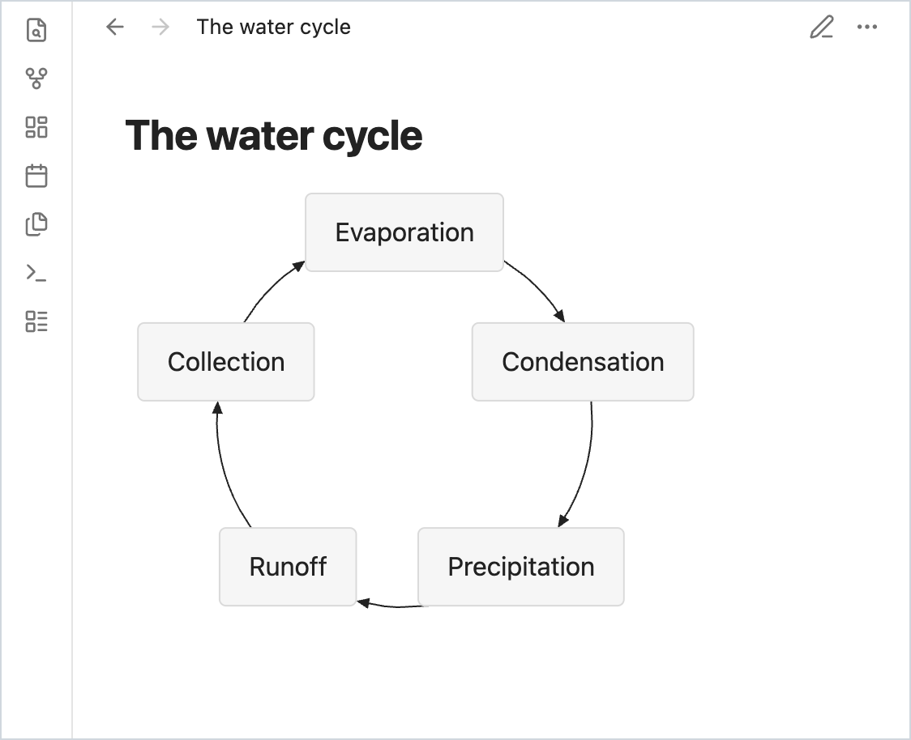

## Usage

Add a frontmatter block, the settings between two `---` lines, at the
top of the diagram. In it, set `layout: circular`:

````
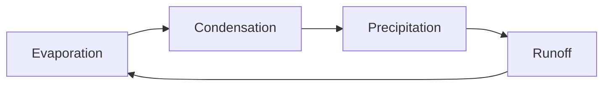
````

`layout: circular` starts at the top and runs clockwise.
`layout: circular-ccw` runs counter-clockwise instead. Obsidian draws
diagrams without either setting as before.

## Install

Until the plugin is in Obsidian's community catalog, install it with
[BRAT](https://community.obsidian.md/plugins/obsidian42-brat), a plugin
that installs other plugins from GitHub.

1. Install and enable BRAT from Obsidian's community plugins.
2. Run the command "BRAT: Plugins: Add a beta plugin for testing", and
   paste `AndrewBroz/obsidian-mermaid-circular`.
3. Enable Mermaid Circular Layout under Settings, Community plugins.

To install it by hand instead:

1. Download `main.js` and `manifest.json` from the
   [latest release](https://github.com/AndrewBroz/obsidian-mermaid-circular/releases/latest),
   or build them yourself (below).
2. Copy both into `<your vault>/.obsidian/plugins/mermaid-circular/`.
3. In Obsidian, enable the plugin under Settings, Community plugins.

Requires Obsidian 1.15 or later.

## Straight edges

By default, an arrow between two neighbors on the circle is curved
along it. Set `flowchart.curve` to `linear` to draw straight lines
instead, so the ring becomes a polygon.

An arrow between two nodes that are not neighbors is called a chord.
A chord is always a straight line across the circle. When two straight
arrows join the same two nodes, they are drawn as parallel lines, each
with its label on its own side.

| Curved arrows (the default) | `curve: linear` |
| --- | --- |
|  |  |

The diagram on the right:

````
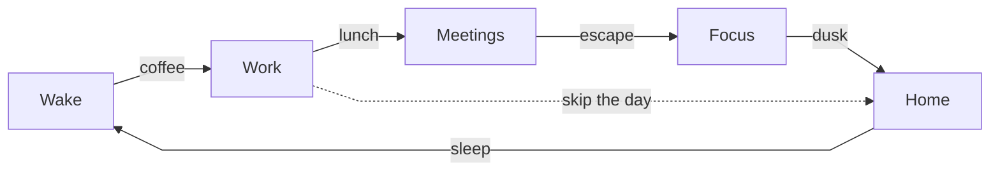
````

## Groups

A subgraph (a group of nodes) keeps its members next to each other on
the circle. A group is drawn as a tight box when one fits, however
much of the circle it covers. The circle turns, if needed, so the box
clears every other node. Where the top of a box has no room for its
title, the title may go below the box instead. A group becomes a band,
a strip that follows the circle, only when no box fits. On the right,
any box around Core would cover Registry. When arrows cross the top of
a box, its title moves to the bottom.

| A group a box can clear: a box | A group no box can clear: a band |
| --- | --- |
|  |  |

## More shapes

The plugin finds these shapes in an ordinary flowchart. A hub is one
node linked to most of the others, and it goes in the middle. The ring
is the circle the nodes sit on. A cycle that hangs off the ring gets
its own smaller circle. Two cycles that share one node make a
figure-eight.

<table>
<tr>
<td align="center"><br>A hub goes in the middle</td>
<td align="center"><br>A wheel: a ring around a hub</td>
</tr>
<tr>
<td align="center"><br>A cycle off the ring gets its own circle</td>
<td align="center"><br>Two cycles sharing a node: a figure-eight</td>
</tr>
</table>

Each picture's source, and more examples, are in
[the gallery](https://github.com/AndrewBroz/pele-layout-circular/blob/main/docs/GALLERY.md).
Its pictures are drawn by Pele, the program Obsidian uses to draw
diagrams, so they match what you see in your notes.

## What carries over

Circular diagrams follow your theme, accent color, font, and light or
dark mode, like every other diagram. Like any diagram in Obsidian, they
ignore mermaid's `theme:` and `look:` settings. Layout options such as
`hub` can't be set in Obsidian yet.

## Limits

The layout's limits are listed under
[Limits](https://github.com/AndrewBroz/pele-layout-circular#limits) in
the pele-layout-circular README.

## How it works

Since version 1.15, Obsidian draws diagrams with
[Pele](https://github.com/obsidianmd/pele), its own diagram renderer.
Pele has its own layout and no way to plug in another. So this plugin
carries a private copy of Pele's flowchart, with the circular layout
added. It steps in only for diagrams that ask for a circular layout.
Obsidian's Pele draws every other diagram, exactly as before.

The layout comes from pele-layout-circular, which uses layout-circular
for the placement math.

The hand-off relies on `pele.mount`, which Obsidian uses internally
but does not document for plugins. A future Obsidian release could
move it. If that happens, the plugin says so in a notice and leaves
your diagrams to Pele. Disabling the plugin also hands circular
diagrams back to Pele.

## Which package to use

The same circular layout comes in four packages. Pick the one that
matches how you draw diagrams.

| You draw diagrams with | Use |
| --- | --- |
| mermaid, in a web page or app | [mermaid-layout-circular](https://github.com/AndrewBroz/mermaid-layout-circular) |
| Pele, in a web page or app | [pele-layout-circular](https://github.com/AndrewBroz/pele-layout-circular) |
| Obsidian, in your notes | this plugin |
| your own code | [layout-circular](https://github.com/AndrewBroz/layout-circular), the shared placement math |

The first three use layout-circular to decide where each node goes.
They place nodes the same way. They differ in how boxes and text are drawn.

## Building from source

```sh
npm install
npm run build
```

This bundles Pele's flowchart and the circular layout into a minified
`main.js` of about 210 KB (about 83 KB gzipped). During development,
`npm run dev` rebuilds on change.

To check a change in a real Obsidian, run a sandboxed instance with the
notes in `sandbox-fixtures/`. It doesn't touch your own app or vaults.

```sh
bash scripts/obsidian-sandbox/obsidian-sandbox.sh start
```

## License

MIT
