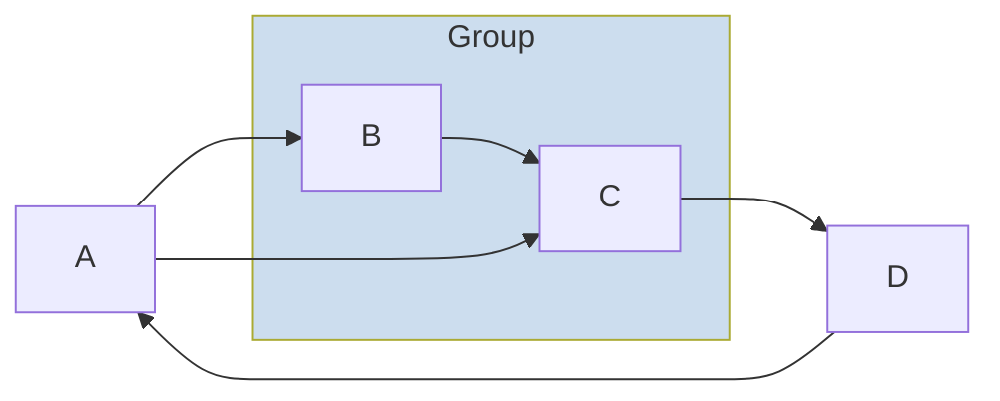
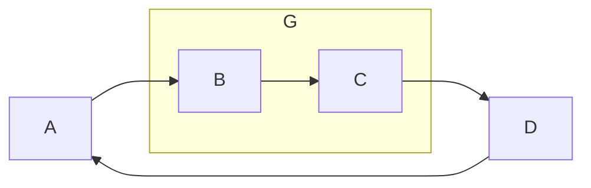
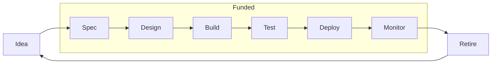
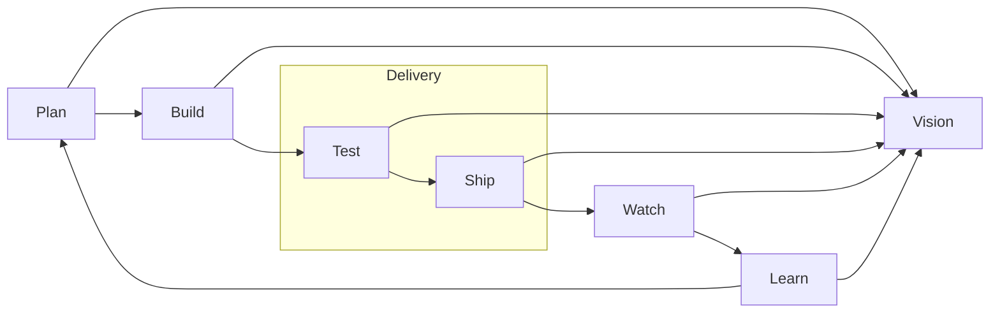

# Groups

A filled group that an edge crosses.

A collapsed subgraph.

A group spanning three quarters of the ring, drawn as a band.

The wheel with a group. Spokes cross the top of the box, so its title
sits at the bottom.

